# Discovery Agent — RS Generator

Monorepo for the AI-Assisted Requirement Specification Generator.

An interactive AI persona that guides business users through defining their needs and automatically generates coherent, standardized Requirement Specification (RS) documents, complete with auto-generated system diagrams. </br>

## System Overview

### Infrastructure
<picture>
  <source media="(prefers-color-scheme: dark)" srcset="./diagrams/infrastructure-simplified-dark.svg">
  <source media="(prefers-color-scheme: light)" srcset="./diagrams/infrastructure-simplified-light.svg">
  
</picture>

### Architecture
<picture>
  <source media="(prefers-color-scheme: dark)" srcset="./diagrams/architecture-simplified-dark.svg">
  <source media="(prefers-color-scheme: light)" srcset="./diagrams/architecture-simplified-light.svg">
  
</picture>

[More diagrams →](./diagrams/README.md)

## Features

- **Conversational Discovery:** Chat with an expert Discovery Agent (Google ADK + Gemini 3.1 Pro) to map out "As-Is" and "To-Be" specifications.
- **Live RS Template:** A sidebar panel tracks and fills all 28 RS fields across 6 sections in real time as the conversation progresses.
- **Automated Diagramming:** Generates BPMN and Dataflow diagrams from conversational context, rendered client-side with Mermaid.js.
- **Document Export:** Compiles the session into standard PDF and Word (DOCX) outputs.
- **Firestore Persistence:** Session state and RS fields are synced continuously to Firestore so progress survives page reloads.
- **Document Uploads:** Upload source documents to Google Cloud Storage for multimodal context extraction via Gemini.

## Structure

```text
/
├── frontend/                              # Next.js app — React, Tailwind CSS, Mermaid.js
│   └── app/
│       ├── components/RsLiveTemplate.tsx  # live RS sidebar component
│       └── generated/rsSchema.ts         # AUTO-GENERATED — do not edit by hand
├── backend/                              # Python — Google ADK, FastAPI, Gemini API
│   ├── field_schema.py                   # canonical RS field definitions (single source of truth)
│   └── scripts/generate_frontend_schema.py  # regenerates frontend/app/generated/rsSchema.ts
└── docs/                                 # project planning documents
```

## RS Field Schema

All 28 RS fields (across 6 sections) are defined once in `backend/field_schema.py`. The frontend TypeScript types and constants are generated from this file — **never edit `frontend/app/generated/rsSchema.ts` by hand**.

To regenerate after changing `field_schema.py`:

```bash
cd backend
.venv/Scripts/python scripts/generate_frontend_schema.py   # Windows
# .venv/bin/python scripts/generate_frontend_schema.py    # Mac/Linux
```

## Getting Started

### Prerequisites

Enable the following APIs in your GCP project:

- Cloud Storage API
- Firestore API
- Gemini API (via `GOOGLE_API_KEY`)

### Backend

The backend requires Python 3.12. Always use the project's virtual environment — never the global interpreter.

```bash
cd backend
python -m venv .venv
.venv/Scripts/python -m pip install -r requirements.txt   # Windows
# .venv/bin/python -m pip install -r requirements.txt    # Mac/Linux

cp .env.example .env   # fill in GOOGLE_API_KEY, GCS bucket, Firestore project, etc.

.venv/Scripts/python -m uvicorn main:app --reload
```

### Frontend

```bash
cd frontend
npm install
cp .env.local.example .env.local   # fill in NEXT_PUBLIC_API_URL and NEXT_PUBLIC_WS_URL
npm run dev
```

## Pre-commit hooks

All code quality checks run automatically before every `git commit` via [pre-commit](https://pre-commit.com).

### Install pre-commit (once per machine)

```bash
pip install pre-commit
```

### Install debtmap (once per machine)

debtmap is not on PyPI. Install it via the official script:

```bash
curl -sSL https://raw.githubusercontent.com/iepathos/debtmap/master/install.sh | bash
```

Verify it landed on your PATH:

```bash
debtmap --version
```

### Activate the hooks (once per clone)

```bash
pre-commit install
```

From this point on, every `git commit` runs all hooks automatically.

### What the hooks check

| Hook | What it checks | Blocks commit? |
| --- | --- | --- |
| `trailing-whitespace` | Trailing whitespace in files | Yes |
| `end-of-file-fixer` | Missing newline at end of file | Yes |
| `check-yaml` / `check-toml` | Syntax of config files | Yes |
| `check-added-large-files` | Accidentally committed large files | Yes |
| `shellcheck` | Shell script linting | Yes (warnings+) |
| `ruff-check` | Python linting (auto-fix enabled) | Yes |
| `ruff-format` | Python formatting | Yes |
| `mypy` | Python type checking | Yes |
| `knip` | Unused TypeScript code and dependencies | Yes |
| `debtmap` | Technical debt — blocks on Critical tier | Yes |

The debtmap hook prints the full report on every commit and **blocks if any Critical-tier items are found**. High, Medium, and Low items are reported but do not block.

### Useful commands

```bash
# Run all hooks manually against every file (useful after first install)
pre-commit run --all-files

# Run only the debtmap check
pre-commit run debtmap --all-files

# See the current debt report without committing
debtmap analyze . --format markdown
```

---

## Running Tests

**Backend:**

```bash
cd backend
.venv/Scripts/python -m pytest tests/
```

**Frontend:**

```bash
cd frontend
npm run test
```
