# System Diagrams

Auto-generated diagrams for the **RS Generator**. See the project [`context.md`](../context.md) and [`docs/confluence/architecture.md`](../docs/confluence/architecture.md) for the authoritative write-ups.

> Diagrams are code-grounded (CI/CD, Dockerfiles, `infra/`, backend/frontend source) and rendered in light + dark themes with animated connections.

---

## Infrastructure

### Overview (Simplified)
<picture>
  <source media="(prefers-color-scheme: dark)" srcset="./infrastructure-simplified-dark.svg">
  <source media="(prefers-color-scheme: light)" srcset="./infrastructure-simplified-light.svg">
  
</picture>

[View simplified documentation](./infrastructure-simplified.md)

### Detailed
<picture>
  <source media="(prefers-color-scheme: dark)" srcset="./infrastructure-dark.svg">
  <source media="(prefers-color-scheme: light)" srcset="./infrastructure-light.svg">
  
</picture>

[View detailed documentation](./infrastructure.md)

---

## Architecture

### Overview (Simplified)
<picture>
  <source media="(prefers-color-scheme: dark)" srcset="./architecture-simplified-dark.svg">
  <source media="(prefers-color-scheme: light)" srcset="./architecture-simplified-light.svg">
  
</picture>

[View simplified documentation](./architecture-simplified.md)

### Detailed
<picture>
  <source media="(prefers-color-scheme: dark)" srcset="./architecture-dark.svg">
  <source media="(prefers-color-scheme: light)" srcset="./architecture-light.svg">
  
</picture>

[View detailed documentation](./architecture.md)

---

## Detail: How `RsLiveTemplate` updates

A focused sequence of the five paths that update the live RS preview during a conversation. Source: `useRsState.ts`, `useRsExtraction.ts`, `page.tsx`, `backend/api/discovery.py`.

<picture>
  <source media="(prefers-color-scheme: dark)" srcset="./rs-live-template-update-dark.svg">
  <source media="(prefers-color-scheme: light)" srcset="./rs-live-template-update-light.svg">
  
</picture>

---

## Documentation

| Document | Description |
|----------|-------------|
| [infrastructure-simplified.md](./infrastructure-simplified.md) | High-level infrastructure overview (8 components) |
| [infrastructure.md](./infrastructure.md) | Detailed infrastructure — compute, data, security, CI/CD |
| [architecture-simplified.md](./architecture-simplified.md) | High-level architecture overview (8 components) |
| [architecture.md](./architecture.md) | Detailed software architecture, data flows, API contracts |

## Reading the diagrams

- **Solid arrows** are synchronous (chat SSE, REST, persistence reads/writes, image pulls).
- **Dashed arrows** are asynchronous / out-of-band (background extraction, finalizer, Firestore→BigQuery export, deploys, secret injection).

## Regenerating

```
/d2:diagram                       # full regeneration (infrastructure + architecture)
/d2:diagram --architecture-only   # architecture only
```

> Note: icons are embedded via D2 `--bundle`. The plugin's `enhance-svg.sh`/`inline-svg-icons.sh` steps are intentionally skipped here — `enhance-svg.sh` corrupts SVGs on D2 v0.7.1, and `inline-svg-icons.sh` needs Go (not installed). Animation is already baked in via `--animate-interval`. For inline icons in GitHub's markdown preview, install Go and run `inline-svg-icons.sh`.
</content>
