# System Diagrams

Auto-generated D2 diagrams for the RS Generator. Four scoped **architecture** views (whole-app, backend, frontend, observability) plus two **user-flow** views (happy path, full interaction & decisions). Each renders in light/dark based on your GitHub theme.

> Icons are embedded as data URIs. If icons don't appear in GitHub's rendered markdown (its SVG sanitizer can strip `<image>` tags), open the SVG file directly — install Go and re-run the plugin's `inline-svg-icons.sh` to make icons GitHub-safe.

---

## Whole-App Architecture
<picture>
  <source media="(prefers-color-scheme: dark)" srcset="./app-dark.svg">
  <source media="(prefers-color-scheme: light)" srcset="./app-light.svg">
  
</picture>

[View documentation](./app.md)

---

## Backend Architecture
<picture>
  <source media="(prefers-color-scheme: dark)" srcset="./backend-dark.svg">
  <source media="(prefers-color-scheme: light)" srcset="./backend-light.svg">
  
</picture>

[View documentation](./backend.md)

---

## Frontend Architecture
<picture>
  <source media="(prefers-color-scheme: dark)" srcset="./frontend-dark.svg">
  <source media="(prefers-color-scheme: light)" srcset="./frontend-light.svg">
  
</picture>

[View documentation](./frontend.md)

---

## Observability & Safety
<picture>
  <source media="(prefers-color-scheme: dark)" srcset="./observability-dark.svg">
  <source media="(prefers-color-scheme: light)" srcset="./observability-light.svg">
  
</picture>

[View documentation](./observability.md)

---

## User Flow — Happy Path
<picture>
  <source media="(prefers-color-scheme: dark)" srcset="./user-flow-happy-path-dark.svg">
  <source media="(prefers-color-scheme: light)" srcset="./user-flow-happy-path-light.svg">
  
</picture>

[View documentation](./user-flow-happy-path.md)

---

## User Flow — Interaction & Decisions
<picture>
  <source media="(prefers-color-scheme: dark)" srcset="./user-flow-dark.svg">
  <source media="(prefers-color-scheme: light)" srcset="./user-flow-light.svg">
  
</picture>

[View documentation](./user-flow.md)

---

## Documentation

| Document | Description |
|----------|-------------|
| [app.md](./app.md) | Whole-app: Cloud Run services, GCP data stores, Gemini, CI/CD |
| [backend.md](./backend.md) | FastAPI routers, ADK agents, generation, persistence |
| [frontend.md](./frontend.md) | Next.js workspace, hooks, API client, panels |
| [observability.md](./observability.md) | Safety preflight, OTel metrics/traces, log metrics, BigQuery, safety jobs |
| [user-flow-happy-path.md](./user-flow-happy-path.md) | User flow: minimal linear golden path (open → chat → finalize → download) |
| [user-flow.md](./user-flow.md) | User flow: full interaction loop, side actions, completeness gates, finalize decision, polling |

## Regenerating

```
/d2:diagram              # Full regeneration
/d2:diagram --incremental # Only changed components
```

Source `.d2` files live alongside the SVGs. Edit a `.d2`, then re-render:

```
d2 --bundle ./diagrams/<name>.d2 ./diagrams/<name>-light.svg --theme 0 --layout elk --animate-interval=1200
d2 --bundle ./diagrams/<name>.d2 ./diagrams/<name>-dark.svg  --theme 200 --layout elk --animate-interval=1200
```
