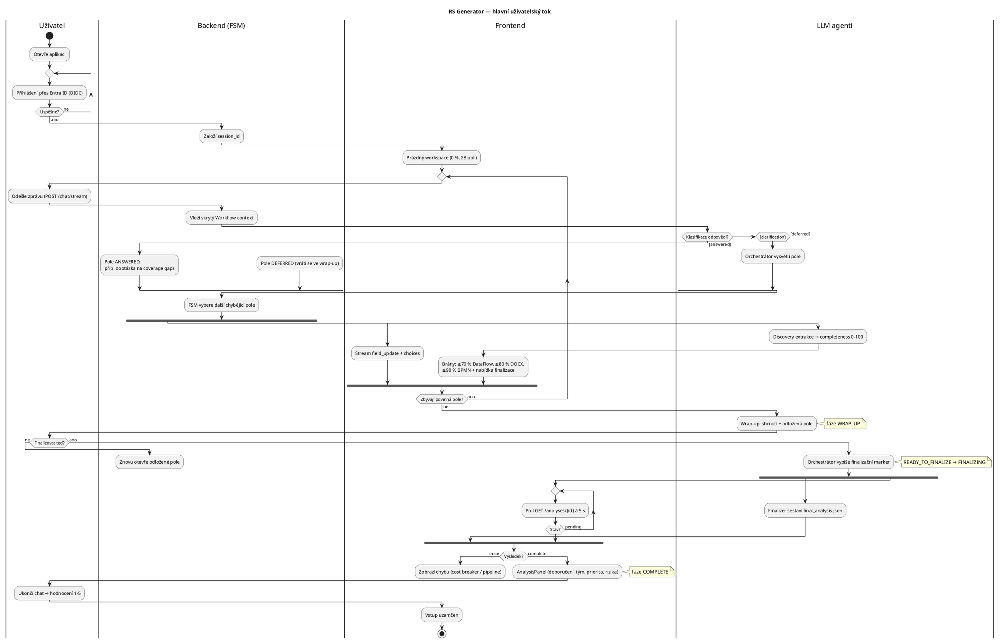

# Popis pro vygenerování UML Activity diagramu — RS Generator

Tento dokument popisuje aktivitní diagram (UML Activity Diagram) hlavního uživatelského
toku RS Generatoru: od přihlášení přes discovery smyčku až po finalizaci a ukončení
session. Popis je strukturován tak, aby z něj šel diagram vygenerovat přímo
(nástrojem nebo LLM); na konci je referenční PlantUML zdroj.

## Rozsah a partitiony (swimlanes)

Diagram má 4 partitiony:

| Partition | Zodpovědnost |
|---|---|
| **Uživatel** | Přihlášení, psaní zpráv, rozhodnutí o finalizaci, hodnocení |
| **Frontend** | UI stavy, brány dle úplnosti, polling analýzy |
| **Backend (FSM)** | Klasifikace odpovědi, přechody fází, výběr dalšího pole |
| **LLM agenti** | Orchestrátor, discovery extraktor, finalizer |

## Tok aktivit

### 1. Vstup (lineární)

1. **Start** → Uživatel otevře aplikaci.
2. Přesměrování na **Microsoft Entra ID** (OAuth2/OIDC).
3. **Rozhodnutí: Přihlášení úspěšné?**
   - Ne → zpět na přihlášení (smyčka).
   - Ano → backend založí `session_id` vázané na identitu.
4. Frontend zobrazí prázdný workspace (0 % úplnosti, 28 polí / 6 sekcí).

### 2. Discovery smyčka (opakuje se každý tah)

5. Uživatel odešle zprávu (`POST /chat/stream`, SSE).
6. Backend vloží skrytý **Workflow context** (fáze, aktivní pole, zodpovězená
   a odložená pole) a předá orchestrátoru.
7. **Rozhodnutí: Klasifikace odpovědi** (klasifikátor, Gemini Flash):
   - **answered** → pole označeno `ANSWERED`; při mezerách v rubrice
     (`coverage_gaps`) položí orchestrátor jednu cílenou dootázku.
   - **clarification_requested** → orchestrátor vysvětlí pole a zeptá se znovu
     (návrat na krok 5, pole se neposouvá).
   - **deferred** → pole označeno `DEFERRED`, vrátí se ve wrap-up.
8. FSM deterministicky vybere **další chybějící pole** dle pořadí schématu;
   orchestrátor položí právě jednu otázku; do UI streamují `field_update`
   události a případná quick-reply tlačítka.
9. **Paralelně (fork, asynchronně):** discovery agent (Gemini Flash Lite)
   extrahuje z celého transkriptu stav všech polí a vrátí **completeness 0–100**
   → zapíše se do Firestore a aktualizuje gauge.
10. **Brány dle úplnosti** (frontend/backend, nezávislé na FSM):
    - ≥ 70 % → odemkne Data-Flow diagram,
    - ≥ 80 % → odemkne stažení RS `.docx`,
    - ≥ 90 % → odemkne BPMN a asistent nabídne finalizaci.
11. **Rozhodnutí: Zbývají povinná pole?**
    - Ano → zpět na krok 5.
    - Ne → přechod do fáze **WRAP_UP**.

Vedlejší akce dostupné kdykoli během smyčky (v diagramu jako poznámka, ne jako
větve): upload souboru, hlasový režim, ruční editace pole, přepnutí CZ/EN,
historie sessions, thumbs feedback.

### 3. Wrap-up a finalizace

12. Orchestrátor shrne známé informace, vyjmenuje odložená pole.
13. **Rozhodnutí: Finalizovat teď?**
    - Ne → odložené pole se znovu otevře, návrat do discovery smyčky (krok 5).
    - Ano → orchestrátor vypíše finalizační marker → FSM přejde
      `READY_TO_FINALIZE → FINALIZING`.
14. **Paralelně:** finalizer (Gemini Pro) kompiluje `final_analysis.json`
    (use_case_form, technology_recommendation, team_profile, priority_tier,
    risk_and_dependencies); frontend zatím polluje `GET /analyses/{id}` à 5 s.
15. **Rozhodnutí: Stav analýzy?**
    - pending → pokračovat v pollingu (smyčka).
    - error → zobrazit chybu (cost circuit breaker / selhání pipeline) → konec větve.
    - complete → zobrazit AnalysisPanel, FSM ve stavu **COMPLETE**.

### 4. Ukončení

16. Uživatel ukončí chat → ohodnotí 1–5 (`POST /feedback/session`) → vstup
    uzamčen → **Konec** (activity final node).

## Konvence pro generátor

- Rozhodovací uzly formulovat jako otázky s pojmenovanými hranami (guard
  podmínky v hranatých závorkách: `[answered]`, `[deferred]`, `[≥ 90 %]`…).
- Asynchronní běhy (discovery extrakce, finalizer) modelovat jako **fork/join**,
  ne jako sekvenci — hlavní tok na ně nečeká.
- Fáze FSM (`DISCOVERY → WRAP_UP → READY_TO_FINALIZE → FINALIZING → COMPLETE`)
  uvádět jako poznámky u příslušných aktivit, ne jako samostatné uzly.
- Chybová větev finalizace končí **flow final** uzlem (ukončí větev, ne celý
  diagram); jediný **activity final** je za ohodnocením session.

## Referenční PlantUML

Pozn.: větev „Finalizovat teď? → ne" se v PlantUML vrací do discovery smyčky;
`detach` je zjednodušení renderu — v cílovém diagramu veďte hranu zpět na
aktivitu „Odešle zprávu".
