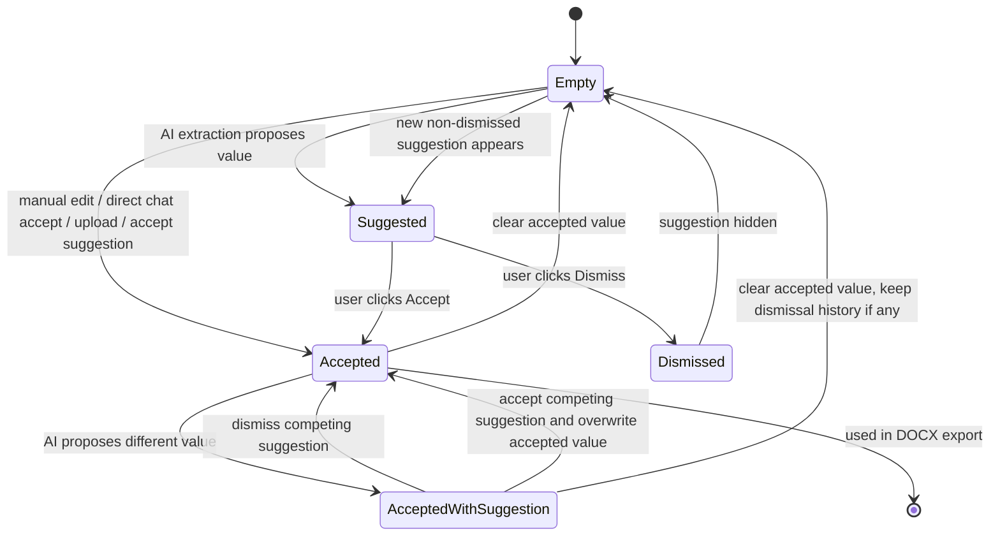

# Accepted RS Field State Flow

Last updated: 2026-06-10

This note describes the agreed flow for separating AI-extracted suggestions from user-accepted RS field values.

## End-To-End Flow

```mermaid
flowchart TD
  A[User input] --> B{Input type}

  B -->|Chat message| C[POST /chat/stream]
  B -->|Manual RsLiveTemplate edit| D[useRsState optimistic update]
  B -->|Upload completes| E[attachments accepted with source user_upload]

  C --> F[Backend loads accepted values from rs_field_state_json]
  F --> G[Workflow identifies active field]
  G --> H{acceptance_mode allows immediate accept?}

  H -->|Yes: direct_answer or literal_value| I[accept_rs_fields source user_direct_chat]
  H -->|No| J[Keep only as conversation input]

  I --> K[Assistant reply streams]
  J --> K

  D --> L[PATCH /discovery or session PATCH queue]
  L --> M[PATCH /discovery/{session_id}/rs-field-state action accept or clear]
  M --> N[Backend writes accepted value in rs_field_state_json with source user_manual]

  E --> O[PATCH /discovery/{session_id}/rs-field-state action accept]
  O --> P[Backend writes attachments accepted value with source user_upload]

  K --> Q[Frontend updates chat bubble]
  Q --> R[POST /context/extract]
  R --> S[Backend extracts AI suggestions]
  S --> T[Backend writes discovery_state_json only]

  T --> U[compose_rs_field_view]
  N --> U
  P --> U
  I --> U

  U --> V{Per field}
  V -->|Accepted exists| W[Return accepted payload]
  V -->|AI suggestion exists and is not dismissed and not equal to accepted| X[Return suggestion payload]
  V -->|Dismissed or duplicate suggestion| Y[Hide suggestion]

  W --> Z[useRsState hydrates RsLiveTemplate]
  X --> Z
  Y --> Z

  Z --> AA{User sees}
  AA -->|Accepted| AB[Show value and accepted source badge]
  AA -->|Suggested| AC[Show suggestion with Accept or Dismiss]
  AA -->|Accepted with suggestion| AD[Show accepted value plus competing suggestion]
  AA -->|Empty| AE[Show placeholder]

  AC --> AF{User action}
  AD --> AF

  AF -->|Accept| AG[PATCH rs-field-state action accept source user_accept_suggestion]
  AG --> AH[Backend stores accepted value in rs_field_state_json]
  AH --> U

  AF -->|Dismiss| AI[PATCH rs-field-state action dismiss]
  AI --> AJ[Backend appends value to dismissed_suggestions]
  AJ --> U

  AB --> AK{User clears field?}
  AD --> AK
  AK -->|Yes| AL[PATCH rs-field-state action clear]
  AL --> AM[Backend removes accepted value and keeps dismissed_suggestions]
  AM --> U

  Z --> AN[Generate DOCX]
  AN --> AO[POST /document/rs-template/docx]
  AO --> AP[Backend reads accepted values only from rs_field_state_json]
  AP --> AQ[Preview and DOCX stay aligned]
```

## Per-Field State



## Storage Rule

`discovery_state_json` stores what AI thinks it found.

`rs_field_state_json` stores what the user has decided: accepted values and dismissed suggestions.

`RsLiveTemplate` shows both accepted values and suggestions. DOCX export uses only accepted values from `rs_field_state_json`.

Accepted values include their source, for example:

```json
{
  "use_case_title": {
    "accepted": {
      "value": "Patents reporting",
      "source": "user_manual",
      "accepted_at": "2026-06-10T11:30:00Z"
    },
    "dismissed_suggestions": []
  }
}
```

Manual edits in `RsLiveTemplate` are accepted immediately with `source: "user_manual"`.
