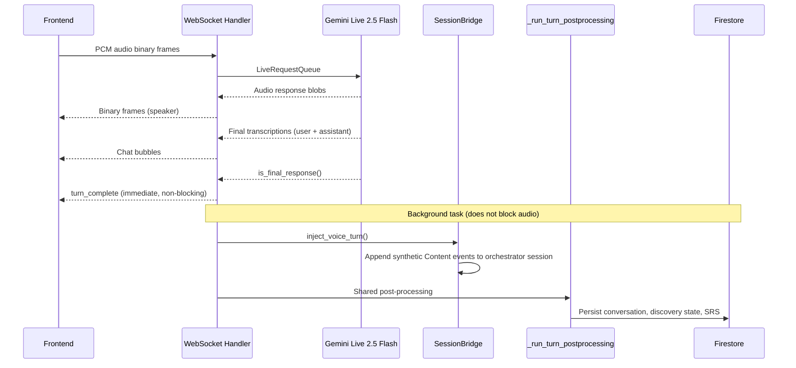

# Speech-to-Text — Architecture Documentation

## Overview

Bidirectional voice streaming integrated into an AI-powered Requirements Specification Generator. Users switch freely between text chat and voice — both paths persist to Firestore, update the 22-field discovery panel, and share full conversational context via a `SessionBridge`.

### Tech Stack

| Layer | Technology |
|-------|------------|
| Frontend | Next.js 16, React, TypeScript |
| Audio I/O | Web Audio API `AudioWorklet` (capture 16kHz, playback 24kHz) |
| Transport | WebSocket (binary PCM + JSON text frames) |
| Backend | Python 3.14, FastAPI, asyncio |
| AI Framework | Google ADK (Agent Development Kit) |
| Voice Model | Gemini Live 2.5 Flash native-audio (`_RegionPinnedGemini` → `europe-west1`) |
| Text Model | Gemini 3.1 Pro |
| Persistence | Firestore, Google Cloud Storage |


## Architecture

```
 FRONTEND (Next.js)                         BACKEND (FastAPI + Google ADK)
 ──────────────────                         ──────────────────────────────

 useAudioRecorder ─── PCM 16kHz ──────────► websocket_audio()
   (AudioWorklet)      binary frames          ├── upstream_task()
                                              │     └► LiveRequestQueue
 useAudioPlayer ◄──── PCM 24kHz ──────────── ├── downstream_task()
   (AudioWorklet)      binary frames          │     └► audio_runner.run_live()
                                              │         (Gemini Live 2.5 Flash)
 useWebSocket ◄─────── JSON frames ──────────┘
   user_transcript,                            on turn_complete
   text, turn_complete                         └► background task:
        │                                         SessionBridge.inject()
 page.tsx                                         _run_turn_postprocessing()
   handleWsMessage()                                ├ Firestore persist
   extractContext()  ◄──── REST polling ────────────├ Discovery extraction
   getFirestoreData()   /context/extract            ├ SRS compilation
                        /analyses/{id}              └ Finalizer (conditional)
```


## Voice Turn Lifecycle




## Key Components

| Component | File | Purpose |
|-----------|------|---------|
| `useAudioRecorder` | `frontend/lib/useAudioRecorder.ts` | Mic capture, PCM downsampling via AudioWorklet (16kHz) |
| `useAudioPlayer` | `frontend/lib/useAudioPlayer.ts` | PCM playback via AudioWorklet ring buffer (24kHz) |
| `useWebSocket` | `frontend/lib/useWebSocket.ts` | WebSocket lifecycle, binary/JSON frame routing |
| `handleWsMessage` | `frontend/app/page.tsx` | Dispatches incoming WS messages to React state |
| `websocket_audio` | `backend/main.py:855` | WS endpoint, concurrent upstream + downstream via `asyncio.gather` |
| `downstream_task` | `backend/main.py:952` | Reads Gemini events, routes audio + transcriptions to client |
| `_run_turn_postprocessing` | `backend/main.py:687` | **Shared** pipeline used by both voice and text chat |
| `_voice_turn_postprocessing` | `backend/main.py:773` | Voice-specific wrapper: SessionBridge + shared pipeline |
| `SessionBridge` | `backend/session_bridge.py` | Injects voice transcripts into text orchestrator ADK session |
| `audio_agent` | `backend/agent/agent.py` | ADK agent — native-audio model, no tools |
| `rs_agent` | `backend/agent/agent.py` | ADK agent — text orchestrator (Gemini 3.1 Pro), research tools |
| `_RegionPinnedGemini` | `backend/agent/agent.py` | Subclass pinning Gemini Live API to configured region |


## SessionBridge

Bridges the context gap between voice and text mode. Both agents share one `InMemorySessionService` but maintain separate event histories. Without the bridge, switching modes loses all prior voice context.

**Mechanism:**
- After each voice turn, creates synthetic `Content` events (user + model role)
- Appends them to the orchestrator session via `session_service.append_event()`
- Model event `author` = `rs_agent.name` for consistency with the text runner
- Lazy session creation for voice-first users
- Empty transcripts are silently skipped (idempotency guard)


## Shared Post-Processing Pipeline

`_run_turn_postprocessing()` eliminates duplication between voice and text:

```
Voice path                    Text path
──────────                    ─────────
_voice_turn_postprocessing    chat_stream (SSE generator)
  │                             │
  ├─ SessionBridge.inject()     │  (voice-only step)
  │                             │
  └──────────┬──────────────────┘
             ▼
  _run_turn_postprocessing()
    1. append_conversation_turn()  → Firestore
    2. Build transcript from ADK session events
    3. extract_discovery_fields()  → Gemini Flash call
    4. upsert_discovery_state()    → Firestore
    5. _persist_srs_to_firestore() → Firestore
    6. run_finalizer()             → if [FINALIZING] marker detected
```


## ADK Voice Event Reference

Events yielded by `audio_runner.run_live()`:

| Field | Payload | Notes |
|-------|---------|-------|
| `event.content.parts[].inline_data` | Audio blob (PCM 24kHz) | Forwarded as binary WS frame |
| `event.input_transcription.text` | User speech-to-text | `event.content` is `None` for these |
| `event.output_transcription.text` | Assistant speech-to-text | `event.content` is `None` for these |
| `event.partial` | `True` incremental / `False` final | Only final transcriptions sent to frontend |
| `event.is_final_response()` | Turn boundary signal | Triggers background post-processing |

Note: Transcription events have `event.content = None`, which is why the `SessionBridge` injects synthetic **Content** events (not transcription events) so that `_extract_conversation_text()` can read them.


## Future Improvements

- **Thread safety** — `InMemorySessionService` is not thread-safe. Concurrent voice + text on the same session may cause race conditions. Consider locking or a session queue.
- **Partial transcription streaming** — Currently only final transcriptions are sent. Streaming partials as a typing indicator would improve perceived responsiveness.
- **Session replay after restart** — InMemory sessions are lost on backend restart. Warm-up from Firestore history would restore context.
